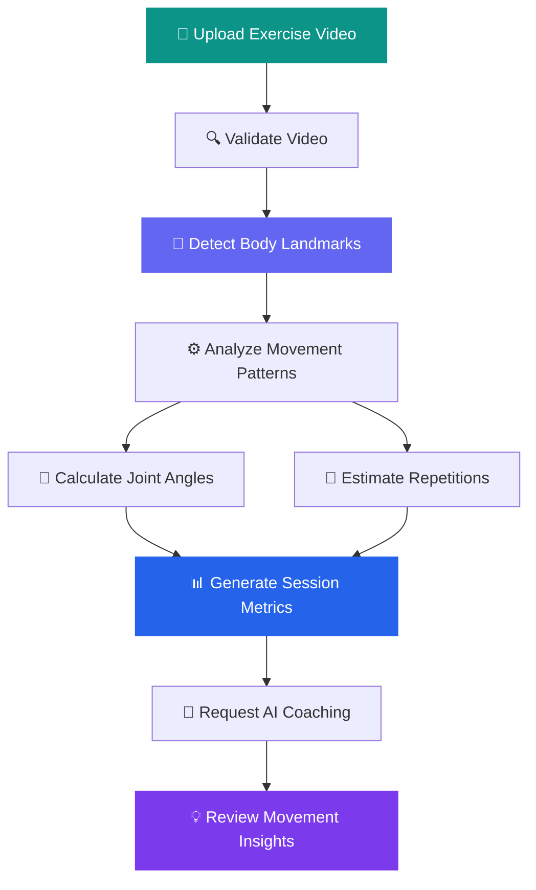
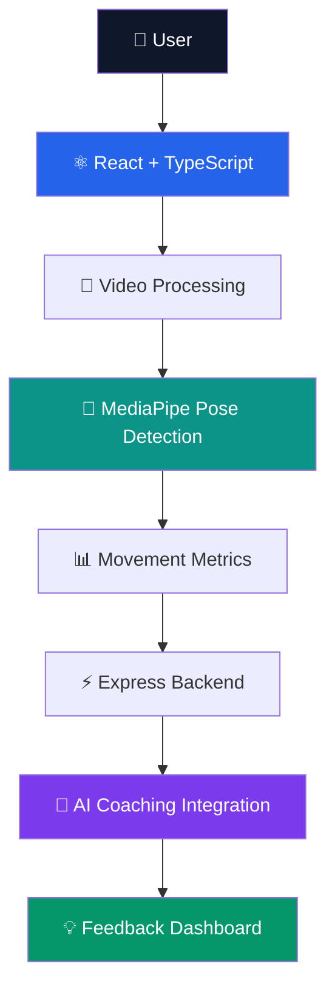

<div align="center">

# 🏃‍♀️ HIPERMOVE
### AI-POWERED MOBILITY & MOVEMENT ANALYSIS

**Move Smarter • Analyze Better • Improve Every Rep**

<br/>


<br/>

### 🚀 Transforming Human Movement Through Artificial Intelligence

**HiperMove** is an AI-assisted movement analysis platform that combines computer vision, pose estimation, movement metrics, and intelligent coaching insights to help users understand and improve exercise technique.

<br/>

[](https://hiper-move-mobility-assistant--motionnn.replit.app/)

[](https://github.com/Madhuri-Kumari2504/HiperMove-Mobility-Assistant)

<br/>

### 💜 Developed by Team codeX
**👑 Team Leader: Alka Kumari**

*Innovation • Intelligence • Impact*

</div>

---

# 🌍 THE VISION

> ### "Every movement tells a story. AI helps us understand it."

Traditional exercise feedback often relies on manual observation and subjective judgment.

**HiperMove** explores how artificial intelligence can support movement analysis by transforming exercise videos into measurable insights.

Our vision is to make movement understanding more accessible through intelligent software.

### 🎯 Our Mission

- Democratize access to AI-assisted movement analysis.
- Transform exercise videos into meaningful metrics.
- Help users understand movement patterns.
- Provide interpretable coaching insights.
- Build a foundation for intelligent fitness applications.

---

# ✨ KEY FEATURES

| Feature | Description |
|:---|:---|
| 🎥 **Video Analysis** | Upload supported exercise videos for movement analysis |
| 🦴 **AI Pose Estimation** | Detect body landmarks using computer vision |
| 🔁 **Repetition Tracking** | Estimate repetitions from movement patterns |
| 📐 **Joint Angle Analysis** | Calculate knee angles and observed angle ranges |
| 📊 **Movement Analytics** | Analyze repetition duration and consistency estimates |
| 🧠 **AI Coaching Insights** | Generate explanations from session metrics through the backend |
| ⚡ **Interactive Dashboard** | Explore results through an intuitive interface |
| 🔄 **Session Management** | Reset and begin a new analysis session |

---

# 🧠 HOW HIPERMOVE WORKS



### 🔬 Analysis Pipeline

| Stage | Operation | Output |
|:---:|---|---|
| 01 | Video Upload | Input exercise footage |
| 02 | Pose Detection | Body landmark coordinates |
| 03 | Motion Analysis | Movement patterns |
| 04 | Joint Angle Calculation | Angle measurements |
| 05 | Repetition Estimation | Repetition count |
| 06 | Metrics Generation | Session summary |
| 07 | AI Coaching | Natural-language feedback |
| 08 | Results Review | Movement insights |

**Current video-processing limit:** Up to 60 seconds per session.

---

# 🛠️ TECHNOLOGY STACK

<div align="center">

### Frontend


### AI & Computer Vision


### Backend & Infrastructure


</div>

### Technology Overview

| Technology | Role |
|---|---|
| React | Interactive user interface |
| TypeScript | Type-safe application development |
| Vite | Development and build tooling |
| MediaPipe Tasks Vision | Pose landmark detection |
| TanStack Query | API fetching and caching |
| Wouter | Client-side routing |
| Tailwind CSS | Responsive styling |
| Lucide React | Icons |
| Node.js | Backend runtime |
| Express | Backend API |
| OpenAI SDK | AI-powered coaching integration |
| Drizzle ORM | Database access |
| Zod | Data validation |
| pnpm | Workspace and dependency management |

---

# 🏗️ SYSTEM ARCHITECTURE



---

# 📂 PROJECT STRUCTURE

```text
HiperMove-Mobility-Assistant/
│
├── HiperMove-Mobility-Assistant/
│   │
│   ├── artifacts/
│   │   ├── hipermove/          # Main application
│   │   ├── api-server/         # Backend API
│   │   └── mockup-sandbox/     # UI experiments
│   │
│   ├── lib/
│   │   ├── api-client-react/   # API client
│   │   ├── api-spec/           # API specification
│   │   ├── api-zod/            # Validation
│   │   └── db/                 # Database layer
│   │
│   ├── scripts/                # Workspace scripts
│   ├── package.json
│   ├── pnpm-lock.yaml
│   ├── pnpm-workspace.yaml
│   └── tsconfig.json
│
└── README.md
```

---

# ⚙️ GETTING STARTED

## Prerequisites

Install:

- Node.js
- pnpm
- Git
- A modern web browser

## 1. Clone Repository

```bash
git clone https://github.com/Madhuri-Kumari2504/HiperMove-Mobility-Assistant.git
```

## 2. Navigate to Project

```bash
cd HiperMove-Mobility-Assistant/HiperMove-Mobility-Assistant
```

## 3. Install Dependencies

```bash
pnpm install
```

If pnpm is not installed:

```bash
npm install -g pnpm
```

## 4. Run Frontend

If the workspace package is named `@workspace/hipermove`:

```bash
pnpm --filter @workspace/hipermove dev
```

Open the local URL shown in your terminal.

## 5. Configure Backend

The AI coaching functionality requires the backend to be running and configured.

Check the backend package scripts and set the required environment variables.

Keep API keys and database credentials server-side.

---

# 🔐 PRIVACY & RESPONSIBLE AI

We believe AI-powered movement analysis should be transparent and responsible.

- Pose estimation is performed in the browser.
- Session metrics may be sent to the configured backend.
- Avoid uploading confidential or sensitive footage.
- Protect backend credentials and API keys.
- Results can vary due to lighting, camera angle, occlusion, and video quality.
- AI coaching explanations are informational and may be imperfect.

> ⚠️ HiperMove is not a medical diagnostic system or a substitute for professional healthcare or fitness guidance.

---

# 🚀 PROJECT ROADMAP

| Phase | Planned Enhancement |
|---|---|
| Phase 1 | Additional exercise recognition |
| Phase 2 | Real-time movement analysis |
| Phase 3 | Pose overlays and angle timelines |
| Phase 4 | Workout history and progress tracking |
| Phase 5 | Side-by-side movement comparison |
| Phase 6 | Enhanced mobile experience |
| Phase 7 | Automated testing and deployment |

These are proposed enhancements, not currently verified capabilities.

---

# 👑 MEET TEAM codeX

<div align="center">

## 💜 The Innovators Behind HiperMove

### TEAM codeX

**Think Bold. Build Smart. Code Beyond Limits.**

*Engineering intelligent solutions for real-world challenges.*

<br/>


</div>

### 👥 Team Information

| Position | Name | Role |
|:---|:---|:---|
| 👑 **Team Leader** | **Alka Kumari** | Team leadership and coordination |
| 👩‍💻 **Project Author** | **Madhuri Kumari** | Project authorship and repository |
| 🚀 **Development Team** | **codeX** | Project development and innovation |

### 💡 Our Philosophy

At **codeX**, we believe technology should solve meaningful problems.

HiperMove reflects our interest in combining artificial intelligence, computer vision, and accessible software to explore a smarter approach to fitness and movement analysis.

### 🌟 Our Values

**Innovation** — Explore new possibilities with AI.

**Collaboration** — Build better solutions together.

**Precision** — Focus on meaningful, measurable insights.

**Impact** — Develop technology with practical value.

---

# 🤝 CONTRIBUTING

We welcome constructive feedback and contributions.

1. Fork the repository.
2. Create a feature branch.
3. Implement and test your changes.
4. Commit with a meaningful message.
5. Submit a pull request.

---

# 📄 LICENSE

Check the project's existing license before redistribution.

A root-level `LICENSE` file should be added to explicitly define usage and contribution rights.

---

# 👩‍💻 PROJECT CREDITS

| | |
|---|---|
| **Project** | HiperMove — AI-Powered Mobility Assistant |
| **Team** | codeX |
| **Team Leader** | Alka Kumari |
| **Author** | Madhuri Kumari |
| **GitHub** | [Madhuri-Kumari2504](https://github.com/Madhuri-Kumari2504) |
| **Repository** | [HiperMove-Mobility-Assistant](https://github.com/Madhuri-Kumari2504/HiperMove-Mobility-Assistant) |
| **Live Demo** | [Launch HiperMove](https://hiper-move-mobility-assistant--motionnn.replit.app/) |

---

<div align="center">

# 💜 BUILT BY TEAM codeX

### 👑 Led by Alka Kumari

### 🏃 HIPERMOVE

**AI-Powered Mobility & Movement Analysis**

<br/>

[](https://hiper-move-mobility-assistant--motionnn.replit.app/)

[](https://github.com/Madhuri-Kumari2504/HiperMove-Mobility-Assistant)

<br/>

### Move Smarter. Analyze Better. Improve Every Rep.

**Innovation • Intelligence • Impact**

Made with ❤️ by **Team codeX**

</div>
