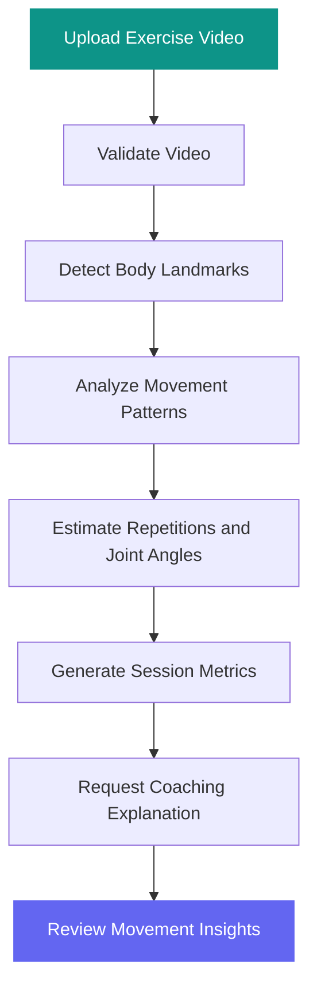

# 🏃 HiperMove
### AI-Powered Mobility & Movement Analysis

<p align="center">
  
  
  
</p>

<p align="center">
  <strong>Move Smarter. Analyze Better. Improve Every Rep.</strong>
</p>

<p align="center">
  HiperMove is an AI-assisted movement analysis application designed to help users understand exercise technique through computer vision, pose estimation, movement metrics, and coaching insights.
</p>

<p align="center">
  <a href="https://hiper-move-mobility-assistant--motionnn.replit.app/">
    
  </a>
  &nbsp;
  <a href="https://github.com/Madhuri-Kumari2504/HiperMove-Mobility-Assistant">
    
  </a>
</p>

---

## 🌐 Experience HiperMove

<p align="center">
  <a href="https://hiper-move-mobility-assistant--motionnn.replit.app/">
    <strong>👉 OPEN THE LIVE APPLICATION</strong>
  </a>
  <br />
  <sub>https://hiper-move-mobility-assistant--motionnn.replit.app/</sub>
</p>

Explore the deployed application and discover how computer vision can support exercise analysis and movement feedback.

## ✨ What Is HiperMove?

HiperMove brings movement analysis and AI-assisted fitness insights into an intuitive digital experience.

By combining video-based pose estimation with movement metrics, the application aims to help users better understand their exercise performance and identify areas for improvement.

Whether you're exploring movement patterns, reviewing repetitions, or examining joint angles, HiperMove provides a foundation for data-informed fitness feedback.

## 🚀 Key Features

| Feature | Description |
|---|---|
| 🎥 Video Analysis | Upload supported exercise videos for analysis. |
| 🦴 Pose Estimation | Detect body landmarks using computer vision. |
| 🔁 Repetition Tracking | Estimate repetitions from detected movement patterns. |
| 📐 Joint Angle Analysis | Calculate knee angles and observed angle ranges. |
| 📊 Movement Metrics | Review metrics such as repetition duration and consistency estimates. |
| 💡 AI Coaching Insights | Request explanations based on session metrics through the backend. |
| ⚡ Interactive Interface | Follow the analysis workflow and review session results. |
| 🔄 Session Management | Reset a session and analyze another video. |

## 🧠 How It Works



### The Analysis Pipeline

1. **Upload:** Select a supported exercise video.
2. **Detect:** Identify body landmarks across sampled video frames.
3. **Analyze:** Estimate repetitions and calculate relevant movement metrics.
4. **Summarize:** Organize the measurements into session results.
5. **Explain:** Use the configured backend to request a coaching explanation.
6. **Review:** Explore the available insights and start another session.

The current analysis workflow processes up to 60 seconds of video per session.

## 🛠️ Technology Stack

<p>
  
  
  
  
  
  
  
  
</p>

| Technology | Role |
|---|---|
| React | User interface |
| TypeScript | Type-safe application logic |
| Vite | Development server and build tooling |
| MediaPipe Tasks Vision | Pose landmark detection |
| TanStack Query | API data fetching and caching |
| Wouter | Client-side routing |
| Tailwind CSS | Styling |
| Lucide React | Icons |
| Node.js and Express | Backend runtime and API framework |
| OpenAI SDK | AI integration |
| Drizzle ORM | Database access |
| Zod | Data validation |
| pnpm | Package and workspace management |

## 📂 Project Structure

```text
HiperMove-Mobility-Assistant/
│
├── HiperMove-Mobility-Assistant/
│   ├── artifacts/
│   │   ├── hipermove/          # Main application
│   │   ├── api-server/         # Backend API
│   │   └── mockup-sandbox/     # UI experimentation
│   │
│   ├── lib/
│   │   ├── api-client-react/   # React API client
│   │   ├── api-spec/           # API specification
│   │   ├── api-zod/             # Validation schemas
│   │   └── db/                  # Database layer
│   │
│   ├── scripts/                 # Workspace scripts
│   ├── package.json
│   ├── pnpm-lock.yaml
│   ├── pnpm-workspace.yaml
│   └── tsconfig.json
│
└── README.md
```

## ⚙️ Getting Started

Want to run HiperMove locally? Follow these steps.

### Prerequisites

Install the following tools:

- [Node.js](https://nodejs.org/)
- [pnpm](https://pnpm.io/)
- [Git](https://git-scm.com/)
- A modern browser

### 1. Clone the repository

```bash
git clone https://github.com/Madhuri-Kumari2504/HiperMove-Mobility-Assistant.git
```

### 2. Enter the project directory

```bash
cd HiperMove-Mobility-Assistant/HiperMove-Mobility-Assistant
```

### 3. Install dependencies

```bash
corepack pnpm install
```

### 4. Start the application

Check the available scripts in the relevant `package.json` files first.

If the workspace package is named `@workspace/hipermove`, start the frontend with:

```bash
corepack pnpm --filter @workspace/hipermove dev
```

Open the local address printed in your terminal.

### 5. Configure the backend

Some features depend on the backend API and its environment configuration. Follow the server's setup instructions, configure the required environment variables, and ensure the frontend points to the correct API address.

**Note:** The exact startup commands may vary depending on the workspace configuration.

## 🔐 Privacy & Responsible Use

- The video analysis workflow uses browser-based pose estimation.
- Session metrics may be sent to the configured backend for coaching explanations.
- Avoid uploading sensitive or personally identifiable footage.
- Secure backend endpoints and environment variables before deployment.
- Results may vary with camera angle, lighting, occlusion, and video quality.

HiperMove provides informational fitness support. Its estimates are not a medical diagnosis or a substitute for qualified medical or fitness guidance.

## 🗺️ Future Enhancements

Potential directions for further development:

- [ ] Support for more exercises and movement types
- [ ] Real-time movement analysis
- [ ] Visual pose overlays and joint-angle timelines
- [ ] Session history and progress tracking
- [ ] Side-by-side movement comparisons
- [ ] Improved mobile experience and accessibility
- [ ] Automated testing and continuous deployment

## 🤝 Contributing

Ideas and contributions are welcome!

1. Fork the repository.
2. Create a feature branch.
3. Implement and test your changes.
4. Commit your work with a descriptive message.
5. Open a pull request explaining your contribution.

## 📄 License

Check the project's existing license and package metadata before redistributing the software. Add a root-level `LICENSE` file to make the repository's licensing terms explicit.

## 👩‍💻 Author

**Madhuri Kumari**

- GitHub: [@Madhuri-Kumari2504](https://github.com/Madhuri-Kumari2504)
- Project Repository: [HiperMove-Mobility-Assistant](https://github.com/Madhuri-Kumari2504/HiperMove-Mobility-Assistant)
- Live Application: [Launch HiperMove](https://hiper-move-mobility-assistant--motionnn.replit.app/)

---

<p align="center">
  <a href="https://hiper-move-mobility-assistant--motionnn.replit.app/">
    <strong>🚀 TRY HIPERMOVE NOW</strong>
  </a>
  <br /><br />
  <em>Understand your movement. Make every rep count.</em>
</p>
